# TruthLens: Deepfake & AI-Fraud Shield

Check a suspicious **image**, **voice note** or **message** and get a risk score, the **evidence behind it**, an honest confidence level and **what to do next**. Built for everyday people in India (UPI, OTP, KYC, "digital arrest" and fake-relative scams), for Codefestthon 2026 (AI/ML track).

> TruthLens never says "100% fake" or "100% real". Detectors are imperfect; every verdict comes with signals, confidence and limitations. See [docs/LIMITATIONS.md](docs/LIMITATIONS.md).

## Screenshots

All captured from the running app on a CPU-only laptop. The sample inputs are the ones in `backend/samples/`: a scam message, a text-to-speech voice clip and a real public-domain photo.

### 1. Paste or upload, then analyse
Four tabs (Image, Voice, Message, Combined), drag-and-drop or mic recording, and a reminder that nothing is stored.

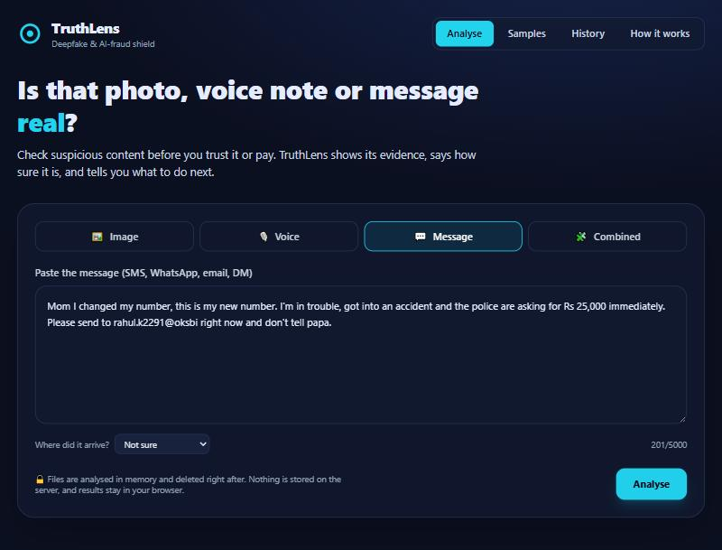

### 2. A verdict you can check: a "son in trouble" message
Score **74/100, High risk**, with high confidence. Suspicious phrases are highlighted and labelled by tactic (family emergency, authority claim, urgency, secrecy), and the UPI ID and amount are pulled out.

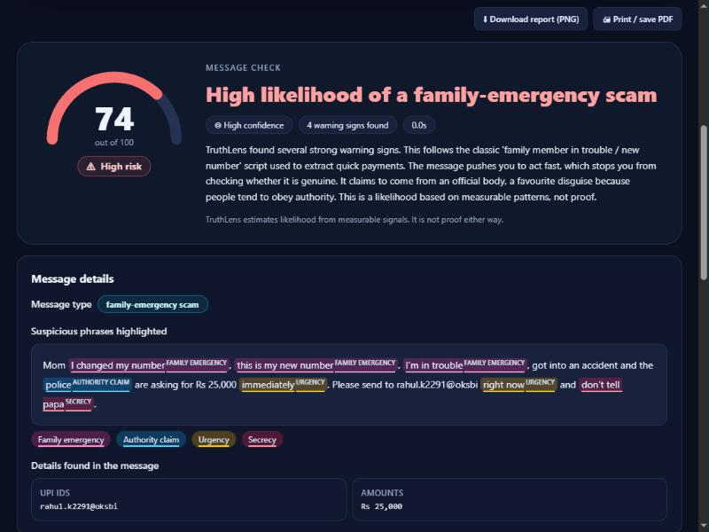

### 3. Evidence and what to do next
Every signal was measured or matched, strongest first; tap one for the plain-language reason. Next steps are India-specific (call back on the saved number, never share an OTP, report at 1930 / cybercrime.gov.in).

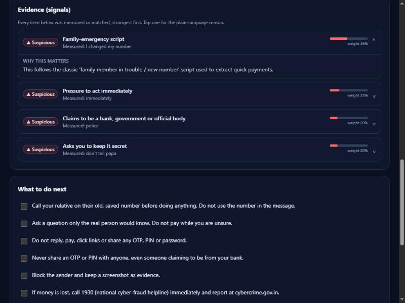

### 4. Combined mode: message + voice + photo
The three checks side by side. Here the message scores 74 and the synthetic-voice clip 65 (Medium). The real photo correctly stays low (29), so it does not drag the verdict down or inflate it. Because the message follows a known scam script and is backed by a suspicious voice, the combined score gets a +10 bonus: **77/100, High**.

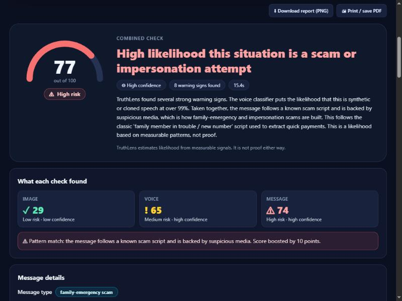

### 5. Voice: waveform and spectrogram
Play the clip and see its waveform and mel spectrogram, so you can judge the sound yourself.

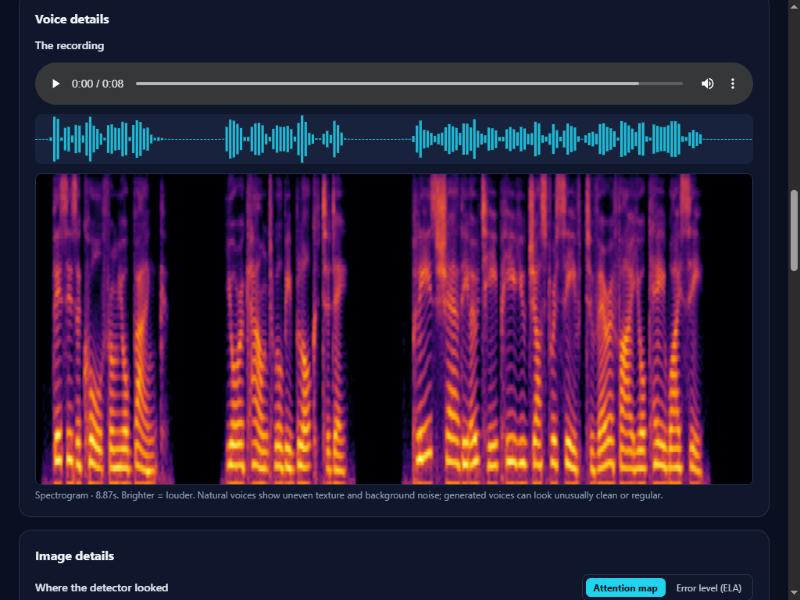

### 6. Image: where the detector looked
A Grad-CAM attention map you can slide against the original, with an Error Level Analysis toggle. This is a *real* photo, and the map is explicitly labelled as "where the model looked, not proof of editing".

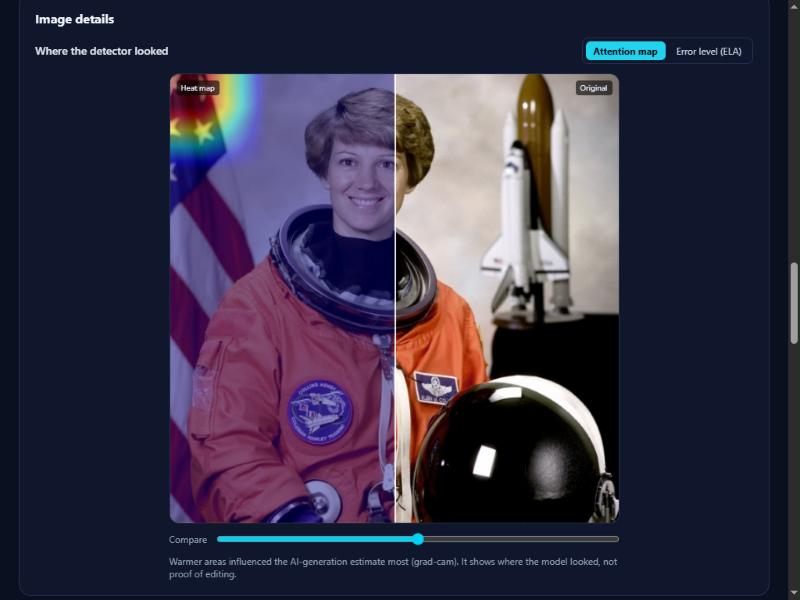

### 7. Limitations are always on screen
Every result ends with the limitations that apply, expanded by default, plus the models that produced it.

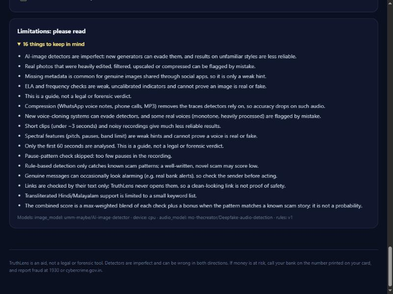

### 8. Samples gallery
One-click demo inputs so a demo never depends on uploads, and a "Run combined demo" button for the family-emergency scenario. "Source label" is where a sample came from, not TruthLens's verdict.

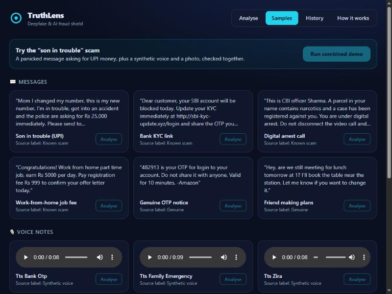

### 9. How it works
The pipeline and an honest summary of what each check can and cannot tell you.

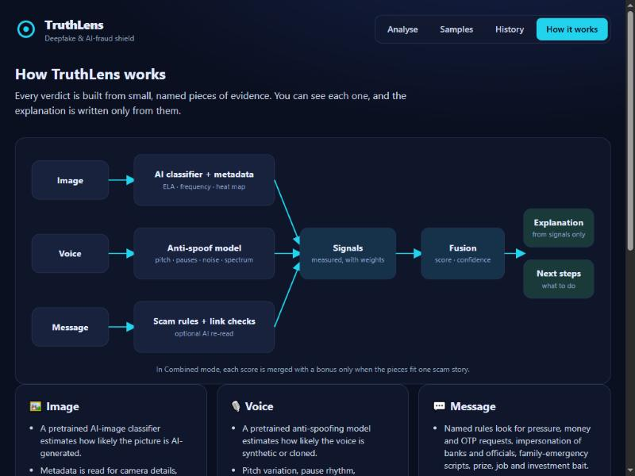

### 10. Phone-sized screens

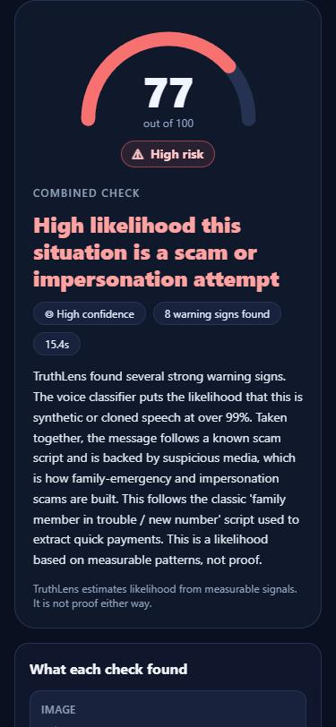

### 11. Chrome extension side panel
The extension's `panel.html` / `panel.js` rendering a real backend result. *This capture was taken with the extension's panel code served as a normal page and a stubbed `chrome` API; the extension itself has not yet been screenshotted inside Chrome.*

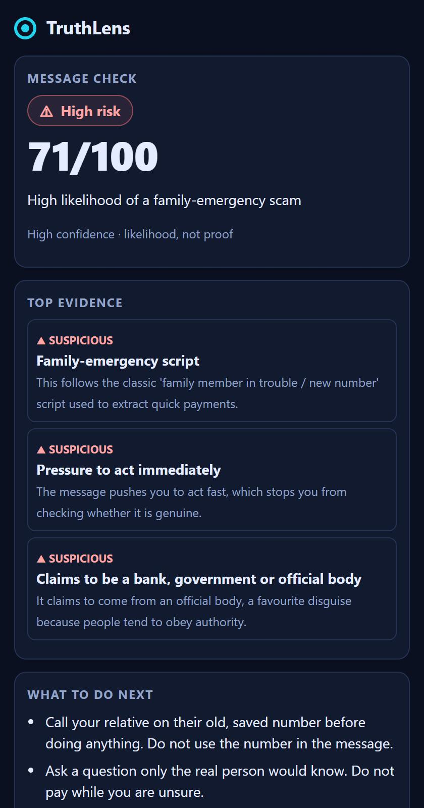

## Features
- **Image:** AI-image classifier, EXIF / embedded-generator / C2PA-claim checks, Error Level Analysis, frequency check, face count, Grad-CAM attention heat map with a compare slider.
- **Voice:** anti-spoof classifier over 6 s windows, pitch / pause / noise / band-limit features, spectrogram and waveform. Reads WhatsApp `.opus` / `.ogg`, `.m4a`, `.mp3`, `.wav`; mic recording in the browser.
- **Message:** 20+ named scam rules (urgency, OTP/PIN, UPI collect, KYC, digital arrest, family emergency, prizes, job fees, investment, remote-access apps...), offline URL analysis (look-alikes, shorteners, punycode, `@` tricks), phrase highlighting, extracted UPI IDs / links / numbers / amounts, scam-type badge.
- **Combined:** image + voice + message fused, with a bonus only when they fit one scam story.
- **Grounded explanations:** written only from measured signals (LLM optional, template fallback).
- **Also:** samples gallery, local history, PNG/PDF report, "How it works" page, Chrome extension, accessibility (keyboard, text + icon risk levels, reduced motion).

## Architecture
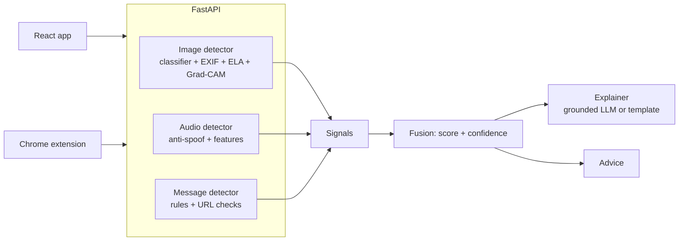
Details and formulas: [docs/ARCHITECTURE.md](docs/ARCHITECTURE.md).

## Quickstart (manual)
Requirements: Python 3.11-3.12, Node 20+, `ffmpeg` on PATH (needed for `.opus` / `.m4a`). Tested on Windows with Python 3.12 and Node 24.

```powershell
# 1. backend
cd backend
py -3.12 -m venv .venv
.venv\Scripts\python -m pip install -r requirements.txt
cd ..
copy .env.example .env                        # optional, defaults work
backend\.venv\Scripts\python scripts\setup_models.py   # downloads roughly 0.7 GB of model weights once
backend\.venv\Scripts\python -m uvicorn app.main:app --app-dir backend --port 8000

# 2. frontend (new terminal)
cd frontend
npm install
npm run dev                                   # http://localhost:5173
```
macOS/Linux: use `python3 -m venv .venv`, `source .venv/bin/activate`, and `cp`. After the models are cached, setting `HF_HUB_OFFLINE=1` makes startup faster and independent of the network.

Optional extras: `python scripts/make_samples.py` (demo audio/photos), `python scripts/smoke_test.py` (checks every endpoint), `python scripts/evaluate.py --data <your labelled folder>`.

## Quickstart (Docker)
```bash
cp .env.example .env   # optional
docker compose up --build
# app: http://localhost:5173   API: http://localhost:8000/api/health
```
CPU-only image; first start downloads the models into a volume. (The Docker files have not been built on the development machine; please report issues.)

## Configuration (`.env`)
| Variable | Default | Meaning |
| --- | --- | --- |
| `IMAGE_MODEL_ID` | `umm-maybe/AI-image-detector` | Hugging Face image classifier |
| `AUDIO_MODEL_ID` | `mo-thecreator/Deepfake-audio-detection` | Hugging Face audio classifier |
| `DEVICE` | `auto` | `auto`, `cpu` or `cuda` |
| `LLM_PROVIDER` | `none` | `anthropic`, `openai`, `gemini`, `ollama`, `none` |
| `LLM_MODEL` / `LLM_API_KEY` / `OLLAMA_URL` | empty / empty / `http://localhost:11434` | Provider settings; sensible default model per provider |
| `LLM_SEND_TEXT` | `true` | Also send message text to the LLM for classification (explainer never gets message text) |
| `MAX_IMAGE_MB` / `MAX_AUDIO_MB` | `10` / `15` | Upload limits (text limit: 5000 chars) |
| `RISK_LOW_MAX` / `RISK_HIGH_MIN` | `35` / `65` | Level thresholds |
| `CORS_ORIGINS` | `http://localhost:5173` | Allowed web origins |
| `PRELOAD_MODELS` | `true` | Warm models at startup |

## Chrome extension
1. Open `chrome://extensions`, enable **Developer mode**.
2. **Load unpacked** and choose the `extension/` folder (Chrome 116+).
3. Start the backend, then right-click an image → *Check image with TruthLens*, or select text → *Check selected text with TruthLens*. Results open in the side panel.
4. Change the backend address in the extension's **Options** (has a *Test connection* button).

The extension asks for access to all sites because it must download images from whatever page you right-click. Selected text and images go only to the backend address you set.

## API reference
| Method & path | Body | Notes |
| --- | --- | --- |
| `GET /api/health` | | device, model load state, LLM status |
| `GET /api/samples` | | demo samples |
| `POST /api/analyze/image` | multipart `file` | ≤ 10 MB |
| `POST /api/analyze/audio` | multipart `file` | ≤ 15 MB, first 60 s analysed |
| `POST /api/analyze/message` | JSON `{text, sender_hint?}` | ≤ 5000 chars |
| `POST /api/analyze/combined` | multipart `image?`, `audio?`, `text?` | at least one |
| `POST /api/analyze/sample/{id}` | | built-in sample |

All return `AnalysisResult`; errors are `{code, message}`. Interactive docs at `/docs` when the backend runs.

## Tests
```powershell
cd backend ; .venv\Scripts\python -m pytest -q     # 63 tests; loads the real models
node extension\test_api.mjs                        # extension API logic (backend must be running)
cd frontend ; npm run lint ; npm run build
python scripts\smoke_test.py                       # every endpoint, pass/fail table
```

## Privacy
Uploads are analysed in memory and discarded; nothing is stored server-side; history keeps only verdict summaries in your browser. Details: [PRIVACY.md](PRIVACY.md).

## Limitations
Accuracy is **not** measured here and varies a lot with compression, new generators and editing. The audio model's behaviour on real speech is untested. Read [docs/LIMITATIONS.md](docs/LIMITATIONS.md) before relying on any result.

## Roadmap
Labelled evaluation set and calibrated thresholds · more languages · video and screenshot support · verified C2PA validation · GPU/ONNX acceleration · stronger face-swap forensics · browser-side message check for WhatsApp Web.

## Credits
Models: [`umm-maybe/AI-image-detector`](https://huggingface.co/umm-maybe/AI-image-detector), [`mo-thecreator/Deepfake-audio-detection`](https://huggingface.co/mo-thecreator/Deepfake-audio-detection) via 🤗 Transformers. Libraries: FastAPI, PyTorch, librosa, OpenCV, scikit-image, pytorch-grad-cam, React, Vite, Tailwind CSS, html2canvas-pro. Example photos: public-domain images from scikit-image. Check each model's license before commercial use.

## License
MIT: see [LICENSE](LICENSE).
